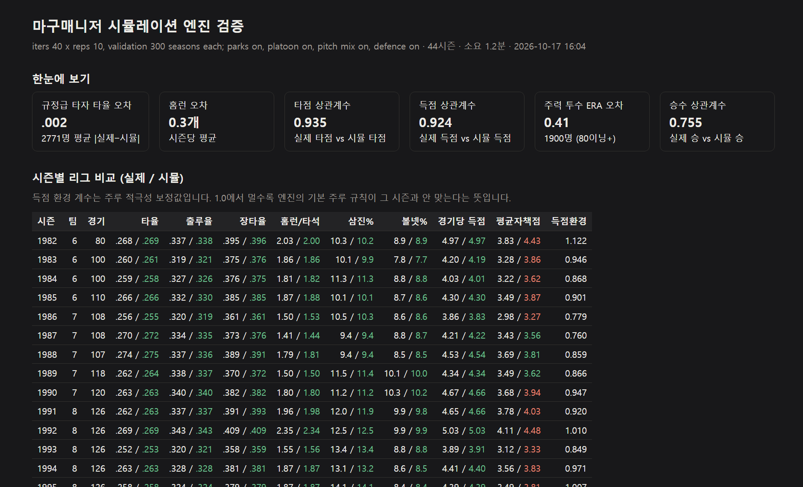
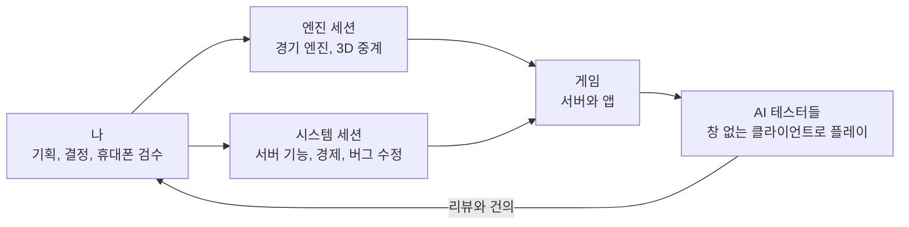

# 마구매니저 부활 프로젝트

서비스가 종료돼 앱만 남은 모바일 야구 매니지먼트 게임 **'마구매니저'(넷마블)**를, AI 코딩 에이전트와 함께 복원하고 새 콘텐츠를 기획·개발한 기록입니다. 2026년 10월 15일에 시작해 지금도 매일 이어 가고 있습니다.

> **공개 범위 안내**
> - 배포와 상업 이용이 없는 개인 프로젝트입니다.
> - 원작 앱은 디컴파일해 통신 규격과 화면 규칙을 분석하고, 서버와 함께 사라진 부분을 새로 만들었습니다. 원작의 코드·그림·데이터는 권리자의 것이므로 이 저장소에 넣지 않았습니다.
> - 이 저장소는 비공개 작업 저장소에서 **직접 만든 코드와 기획 문서만 골라 옮긴 편집본**입니다. 원작 자산, 내부 접속 정보, 개인 정보가 들어간 파일과 문장은 뺐습니다. 그래서 서버와 앱은 이 공개본만으로는 빌드되지 않습니다.
> - 전체 작업은 비공개로 보관하고 있으며, 요청하시면 실제 플레이와 함께 보여 드릴 수 있습니다.
> - KBO 공식 사이트는 자동 수집을 금지하므로 수집하지 않았습니다.

## 한눈에

| 항목 | 내용 |
|---|---|
| 기간 | 2026-10-15 ~ 진행 중 (첫 APK 10-19, 최신 1.0.59 11-20, 한 달 동안 59개 버전) |
| 역할 | 기획 전체, 작업 구조 설계, 의사결정, 실기기 검수 (코드는 Claude Code 에이전트가 작성) |
| 게임 서버 | C# .NET 8, 약 3.9만 줄. 원작 앱이 보내는 요청 107종을 처리 |
| 경기 엔진 | 약 1.5만 줄. 1982~2025 KBO 44시즌을 재현하며 선수 능력치를 보정 (주전 타자 타율 오차 .002, 80이닝 이상 투수 평균자책점 평균 오차 0.41) |
| 앱 | 32비트 원작을 Unity 6.3 64비트로 이식(최신 휴대폰에서 실행). 새로 쓴 코드 약 2.2만 줄 |
| 도구 | 카드 산출, 밸런스 시뮬레이션, 육성 분석, AI 테스터 등 약 3.8만 줄 |
| 기록 | 기획기록(제가 입력한 기획 원문과 고른 선택지, 약 46만 자), 릴리즈 이력(59개 버전마다 바뀐 점·버그 원인) |

## 기획 이력

| 주 | 기획과 결정 | APK |
|---|---|---|
| 10-15 ~ 10-18 | 원작 앱을 분석해 사라진 것(서버 규칙·데이터 표·이미지)과 남은 것(화면·통신 규격)을 나눔. 경기 엔진을 실제 KBO 44시즌으로 검증(10-17). 아이콘만 남은 팀 특성 트리를 기억으로 복원하고, 같은 전력끼리 맞붙이는 시뮬레이션으로 특성 1점의 승률 기여도를 재서 값을 정함 | 없음 |
| 10-19 ~ 10-25 | 첫 APK로 휴대폰에서 다시 실행(10-19). 오늘의 미션·업적(10-20), 정규시즌 시상(10-21), 특별수강과 공통 리그 일정(10-22), 투수 포지션 변경(10-24), 트레이닝북 교환소(10-25) | 1.0.1 ~ 1.0.15 |
| 10-26 ~ 11-01 | 수비 엔진을 타구 물리·수비 범위·송구로 다시 설계해 라이브 적용(10-30~31), 실제 수비 기록으로 맞춤(11-01) | 1.0.16 ~ 1.0.27 |
| 11-02 ~ 11-08 | 공개 기록으로 1993~2026 카드 능력치를 다시 산출(11-02). 새벽 자동 시범경기(11-03). 능력치의 의미를 설계대로 다시 매김(11-05). 레전드 카드(11-08) | 1.0.28 ~ 1.0.35 |
| 11-09 ~ 11-15 | 성향이 다른 AI 테스터들이 실제 화면을 플레이하고 리뷰(11-09~). 팀 가치 평가와 자동 편성·특성 추천(11-11). 쿠폰 없이 자급자족하는 테스터로 콘텐츠 소모 속도 측정(11-13). 보상·MP 장부(11-14). FA 선수카드, 시즌마다 바뀌는 공인구와 득점 환경(11-15) | 1.0.36 ~ 1.0.53 |
| 11-16 ~ 11-20 | FA 에이전트 협상·재계약 협상, 계약서 서명과 입단식 연출(11-17). 모든 글상자를 넘침 검사하는 규칙(11-17). 정규시즌 결산 시상대(11-19). AI 테스터 운영을 짧은 회차와 가벼운 모델로 바꿔 토큰 사용량을 줄임(11-19~20) | 1.0.54 ~ 1.0.59 |

결정 아홉 건을 요청 원문, 선택지, 결과 순으로 뽑은 것이 [docs/기획_하이라이트.md](docs/기획_하이라이트.md)입니다. 날마다의 기획 원문은 [docs/기록/기획기록_1부_지난대화.md](docs/기록/기획기록_1부_지난대화.md)(10-15~)와 [docs/기록/기획기록.md](docs/기록/기획기록.md)(11-05~)에, 버전마다 바뀐 점은 [docs/기록/릴리즈이력.md](docs/기록/릴리즈이력.md)에 있습니다. 11-11부터는 하루 작업을 마칠 때마다 커밋했습니다.

## AI와 일하는 방식

- Claude Code 세션을 경기 시뮬레이션·3D 중계 담당과 서버 기능·경제·버그 수정 담당으로 나눠 동시에 운영합니다. 파일 소유권, 공유 파일은 덧붙이는 수정만 한다는 것, 서버 재시작 전에 상대 세션과 저에게 알리는 것, 자동 테스트는 전용 계정과 데이터 사본에서만 하는 것, 빌드는 제가 승인한 뒤에만 하는 것 같은 규칙은 [CLAUDE.md](CLAUDE.md)에 있습니다.
- 문제가 생기면 원인을 한 줄 규칙으로 더합니다. 시뮬레이션 6개를 동시에 돌렸다가 PC가 멈춘 뒤로는 한 번에 하나만 돌리고 코어 2개를 비워 둡니다.
- 결정과 이유는 AI 장기 메모리에, 제 기획 원문은 기획기록에, 바뀐 점은 빌드 전에 릴리즈 이력에 남겨 새 세션도 같은 맥락에서 시작합니다.
- 성향이 다른 AI 테스터들이 창 없는 게임 클라이언트를 글로 읽고 눌러 가며 플레이하고 리뷰를 남깁니다([docs/AI테스터/AI테스터_패널.md](docs/AI테스터/AI테스터_패널.md), [.claude/skills/ma9m-tester](.claude/skills/ma9m-tester)).
- 테스터의 토큰 사용량을 재서 줄였습니다. 화면을 캡처 대신 글로 읽게 하고, 되풀이되는 조작은 매크로로 묶고, 한 회를 2시간에서 30분 안으로 끊었습니다. 테스터 한 명의 한 회 사용량은 33만~40만 토큰에서 9만~12만 토큰으로, 하룻밤 전체는 200만 토큰 이상에서 약 21만 토큰으로 줄었습니다. 플레이는 가벼운 모델이 하고 리뷰 분석은 상위 모델이 합니다([tools/ai_tester/COORDINATOR.md](tools/ai_tester/COORDINATOR.md)).
- 문제 정의, 선택지 중 결정, 휴대폰 실사용 검수, 빌드와 서버 재시작 승인은 제가 합니다.

## 대표 코드

코드 맨 위 주석에는 그 기능을 요청한 제 말과 결정이 적혀 있습니다.

| 파일 | 내용 |
|---|---|
| [server/Ma9MServer/FaNegotiation.cs](server/Ma9MServer/FaNegotiation.cs) | FA 에이전트 협상의 서버 규칙. 선수 성향, 만족도 게이지, 계약 조건 |
| [server/Ma9MServer/League/SeasonBall.cs](server/Ma9MServer/League/SeasonBall.cs) | 시즌마다 공인구를 뽑아 그 시즌의 득점 환경을 정하는 규칙 |
| [server/Ma9MServer/League/AutoLineup.cs](server/Ma9MServer/League/AutoLineup.cs) | 볼 상한 안에서 가장 강한 1군을 찾는 자동 편성 |
| [sim/Ma9MSim/TeamValue.cs](sim/Ma9MSim/TeamValue.cs) | 경기를 돌리지 않고 팀 전력을 득점으로 셈하는 평가. 자동 편성과 특성 추천이 씀 |
| [sim/Ma9MSim/Fielding](sim/Ma9MSim/Fielding) | 수비 엔진. 타구 물리(BattedBall, Flight), 수비 계획과 판정(Plan, Resolve) |
| [server/Ma9MServer/Training/TrainingQuick.cs](server/Ma9MServer/Training/TrainingQuick.cs) | 트레이닝북 빠른 조합과 목표 교환 |
| [port/Ma9MClient/Assets/Scripts/Ma9MPort/Ma9MRemote.cs](port/Ma9MClient/Assets/Scripts/Ma9MPort/Ma9MRemote.cs) | 창 없는 게임 클라이언트를 글 명령으로 조작하는 원격 조작. AI 테스터가 이것으로 플레이 |
| [port/Ma9MClient/Assets/Scripts/Ma9MPort/Ma9MTextBox.cs](port/Ma9MClient/Assets/Scripts/Ma9MPort/Ma9MTextBox.cs) | 모든 글상자가 쓰는 줄 바꿈과 스크롤 |

## 폴더 안내

| 경로 | 내용 |
|---|---|
| [server/Ma9MServer](server/Ma9MServer) | 게임 서버(로그인, 로스터, 리그, 카드, 경제, 코칭스태프, FA 협상 등) |
| [sim/Ma9MSim](sim/Ma9MSim) | 시즌 재현 경기 엔진과 수비 엔진 |
| [port/Ma9MClient/Assets/Scripts/Ma9MPort](port/Ma9MClient/Assets/Scripts/Ma9MPort) | 앱에 새로 만든 화면·기능 코드 |
| [port/Ma9MClient/Assets/Editor/Ma9MPort](port/Ma9MClient/Assets/Editor/Ma9MPort) | 빌드 스크립트 |
| [tools](tools) | 카드 산출, 육성 분석, 특성 시뮬레이터, AI 테스터 도구 |
| [docs](docs) | 문서 안내, 기획 하이라이트, 설계 문서(수비 엔진, FA 협상, 특성 균형, 득점 환경), 기획기록과 릴리즈 이력 원문, AI 테스터 리뷰 |
